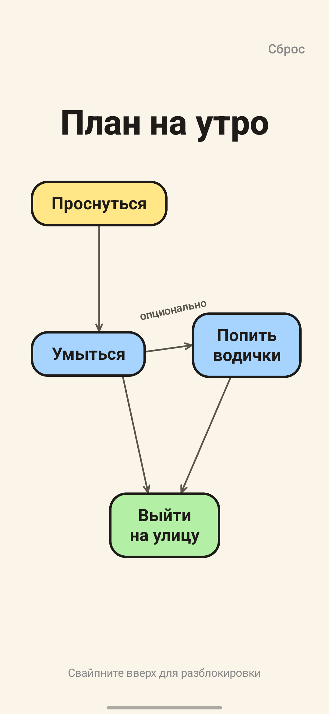
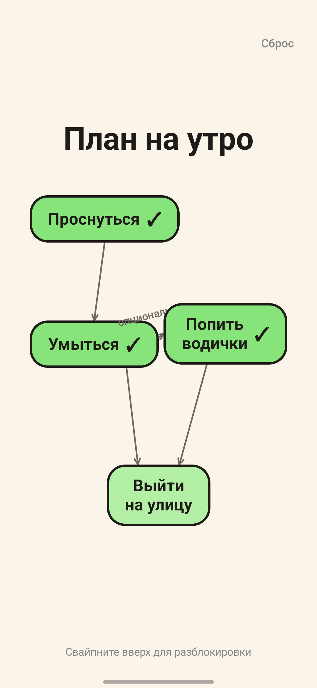

# Morning Plan (План на утро) ☀️

Android-приложение на **Kotlin + Jetpack Compose**, которое отображает интерактивную схему утренней рутины поверх экрана блокировки (lockscreen).

> 💡 **Концепт и дизайн:**
> - Исходная схема и картинка были сгенерированы с помощью **GEMINI**.
> - Визуальный референс и стиль оформления взяты из **Excalidraw**.

---

## 📱 Как это работает

1. **Экран выключен / заблокирован.**
2. Нажимаете кнопку питания или делаете двойной тап по экрану — сразу поверх стандартной блокировки открывается экран со схемой утреннего плана.
3. **Тапаете по карточкам** («Проснуться», «Умыться», «Попить водички», «Выйти на улицу») — выполненные дела перекрашиваются в зелёный цвет и получают отметку `✓`. Состояние сохраняется даже при повторном включении экрана.
4. **Свайпаете снизу вверх** — экран приложения плавно закрывается, открывая системный ввод PIN-кода или сканер отпечатка пальца (Samsung / One UI).
5. В правом верхнем углу есть кнопка **«Сброс»**, чтобы обнулить пункты на следующее утро.

---

## 📸 Сравнение с референсом и демонстрация

| Исходный референс (GEMINI / Excalidraw) | Экран блокировки (Приложение) | Выполненные задачи |
| :---: | :---: | :---: |
|  |  |  |

### 🎥 Видео демонстрации работы
В репозитории прикреплен видеоролик тестирования на реальном смартфоне:
▶️ [Посмотреть видео demo.mp4](assets/demo.mp4)

---

## 🛠 Технологии и архитектура

- **Язык**: Kotlin 2.0+
- **UI Toolkit**: Jetpack Compose (Material 3)
- **Фоновая служба**: `LockscreenService` (`ForegroundService`) с отслеживанием `ACTION_SCREEN_OFF` и `ACTION_SCREEN_ON`
- **Отображение поверх блокировки**: `showWhenLocked="true"`, `turnScreenOn="true"`, `setShowWhenLocked(true)`, `setTurnScreenOn(true)`
- **Разблокировка**: `KeyguardManager.requestDismissKeyguard`
- **Сохранение состояния**: `SharedPreferences`

---

## 🚀 Сборка и установка

### Сборка через Gradle:
```bash
./gradlew assembleDebug
```

Собранный APK будет находиться в папке:
`app/build/outputs/apk/debug/app-debug.apk`

### Установка на телефон через ADB:
```bash
adb install -r app/build/outputs/apk/debug/app-debug.apk
```

### Настройки на смартфонах Samsung (One UI):
1. Откройте приложение и нажмите **«Служба активна»**.
2. Разрешите показ **«Поверх других приложений»** (Display over other apps).
3. В **Настройки телефона → Приложения → План на утро → Батарея** выберите **«Не ограничено»**, чтобы система не выгружала службу в фоне.
